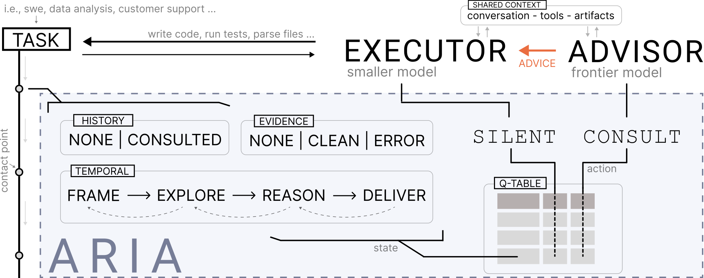

# ARIA: Ask Your Advisor

[](https://arxiv.org/abs/2610.13870)



To balance task performance and computational cost, agentic workflows can use
a lower-cost model for execution and selectively consult a stronger model. In
such executor-advisor systems the executor usually decides itself when to seek
advice, so escalation depends on the executor's own self-assessment. The need
for stronger reasoning emerges during execution and varies across workflow
phases.

ARIA (Allocation of Reasoning In Agentic systems) is a meta-controller that
learns when to consult by balancing task success against consultation cost.
It treats consultation as a sequential resource-allocation problem: at
workflow contact points, ARIA maps execution evidence to a compact state
abstraction and selects SILENT or CONSULT, with action values learned by Monte
Carlo control from cost-penalised outcomes. The learned policies are compact
and inspectable, and a single consultation-price parameter sets the trade-off
without retraining either model.

This repository contains the framework behind the paper
[Ask Your Advisor: Learning When to Consult Stronger Models in Agentic Systems](https://arxiv.org/abs/2610.13870).
It is built on AutoGen.

## How it works

- **Executor team.** An AutoGen MagenticOne group chat with agents from
  Magentic-UI (a coder that writes and runs code blocks, a read-only file
  surfer, or plain assistants with tools). Roster, prompts and step budgets
  come from a per-benchmark team spec.
- **Contact points.** The orchestrator hook raises a decision at three
  structural moments: before each instruction is dispatched (`PRE_STEP`),
  before the final answer once the team reports the task done
  (`PRE_DELIVERY`) and before a stall replan (`STALL`).
- **Actions.** SILENT, or CONSULT: the advisor receives the task header and
  the executor's status, answers with an assessment and short guidance, and
  the guidance is injected into the team's conversation. The executor stays
  in control.
- **State.** A layout of small discrete dimensions, chosen in config. The
  default `position4 x exec3 x consult` has 24 cells: structural position in
  the episode, the verdict of the last executed action (read from process
  output only, never from model text) and whether the advisor was already
  consulted. `outcome3` replaces `exec3` for tool-calling environments.
- **Learning.** Tabular every-visit Monte Carlo control: epsilon-greedy
  exploration with a linear anneal, each cell holds the mean of its observed
  returns (alpha = 1/n), gamma = 1.
- **Reward.** `R = r_T - lambda * C`. `r_T` is the benchmark's own score in
  [0, 1] at episode end; every CONSULT is charged a declared price,
  normalised by measured cost anchors, so lambda has a dollar reading.
- **Budget.** An optional per-episode cap on consults.
- **Evaluation.** The learned table is frozen (greedy, no exploration, no
  updates) and run on the held-out split.

## What is in this repository

The framework only: the controller, learner, reward model, advisor client,
AutoGen integration, experiment runner, telemetry and CLIs.

Not included: benchmark adapters, task splits, trained policies and run
configs. You bring your own adapter (see
[docs/adapters.md](docs/adapters.md)) and your own configs. The code reads
configs from conventional paths relative to the working directory
(`configs/teams/`, `configs/base/default.yaml`, `configs/families.yaml`); none
of them ship with the package.

## Install

Python 3.11 to 3.13 (CI also runs 3.14 as a non-blocking job).

```bash
python -m venv .venv
.venv/bin/python -m pip install -e ".[dev]"
```

The AutoGen packages are pinned to exactly 0.7.5 because the orchestrator
mirrors private methods of that version.

## Quickstart

1. Plug in a benchmark. [docs/adapters.md](docs/adapters.md) walks through a
   complete toy benchmark: adapter, team spec, phase schema, matrix and the
   small driver that registers the adapter before the CLI runs. Every config
   field is described in [docs/configuration.md](docs/configuration.md).

2. In your own project, before the first paid run, check keys, endpoints
   and prices with one short call per role (from the project directory, with
   the venv active or by its path):

   ```bash
   .venv/bin/aria-preflight configs/base/default.yaml
   ```

   Read [Security](#security) before that run: the stock coder executes
   model-written code on your machine.

## Results layout

```
results/<benchmark>/<condition>/<framework>/<mode>/<executor_model>/seed_<n>/
    run_manifest.json   episodes.jsonl   calls.jsonl   cost_summary.json
    traces/episode_*.json
    checkpoints/checkpoint_ep*.json      (aria condition, train mode)
```

The manifest records the full config without API keys, the task order, the
team runtime knobs, the contact points the runner supports and the
`state_signature` (state layout plus phase schema hash). `aria-eval --policy`
refuses to load a promoted policy under a different signature. A raw
checkpoint (`--checkpoint` or `condition_options.checkpoint`) is checked only
against the state layout, not against `phases.yaml`.

## Security

- The `coder` and `code_executor` kinds run the model's code blocks on the
  host through `python_exec` (AutoGen's `LocalCommandLineCodeExecutor`), with
  your user's permissions and no sandbox. Run untrusted tasks or models
  inside a VM or container.
- `python_exec` and the `file_browser` tools work in the episode workspace.
  When `prepare_workspace` returns `None` (the default) that is the current
  working directory, so return a private, disposable directory instead.
- Code the coder runs can read any file your user can, `aria_secrets.yaml`
  included wherever it lives, and can echo it into the transcript, the
  traces and the provider request. Where that matters, run in a container or
  VM that holds only this run's key, ideally one with a spending limit.
- With `advisor.repo_access` the advisor runs whitelisted inspection
  commands. The whitelist checks the command name, not every flag
  (`find -exec`, for example, is not blocked), so it guards against
  accidents, not against a hostile model.

## Secrets

Copy `aria_secrets.example.yaml` to `aria_secrets.yaml` in the working
directory and fill in the key. `api_key` is the default for both roles;
`executor_api_key` and `advisor_api_key` override it per role. Keys are merged
in at load time and never written to manifests. `aria-train`, `aria-eval`,
`aria-run` and `aria-preflight` accept `--secrets PATH` for a different file.
Keep the file out of version control.

## Documentation

- [docs/adapters.md](docs/adapters.md): plugging in a benchmark, with a
  runnable toy example
- [docs/configuration.md](docs/configuration.md): config files and fields
- [docs/experiment-setup.md](docs/experiment-setup.md): concepts, setting up
  your own experiment, and setup patterns for common benchmark kinds

## Citation

```bibtex
@misc{sowietzki2026ask,
  title         = {Ask Your Advisor: Learning When to Consult Stronger Models in Agentic Systems},
  author        = {Sowietzki, Pascal and Holter, Steffen and Metz, Yannick and Kasper, Emil and Baur, Raphael and El-Assady, Mennatallah},
  year          = {2026},
  eprint        = {2610.13870},
  archivePrefix = {arXiv},
  primaryClass  = {cs.MA},
  url           = {https://arxiv.org/abs/2610.13870}
}
```

## License

MIT, see [LICENSE](LICENSE). Code adapted from AutoGen and Magentic-UI is
listed in [THIRD_PARTY_NOTICES.md](THIRD_PARTY_NOTICES.md). Citation metadata
is in [CITATION.cff](CITATION.cff).
